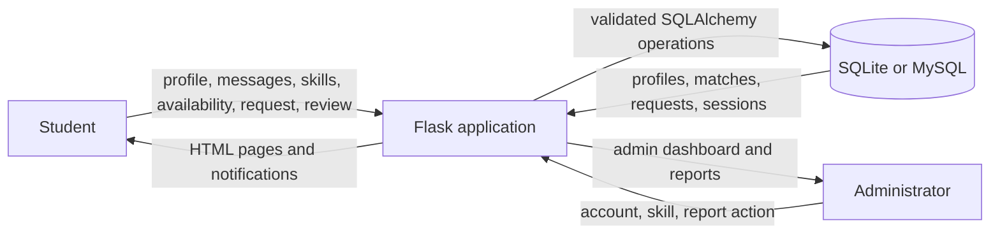
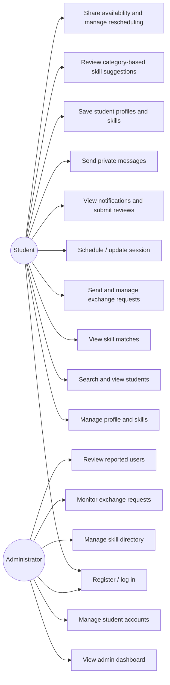
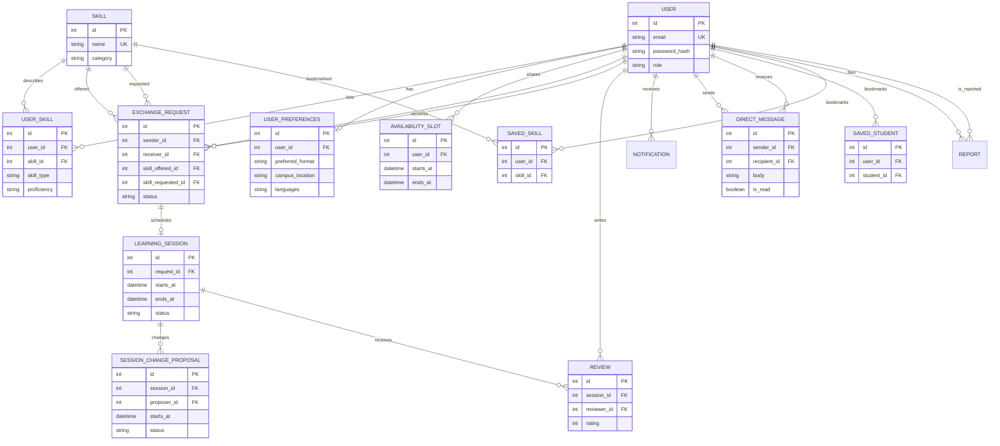

# Campus Skill Exchange — Project Report

## Abstract

Campus Skill Exchange is a local web application that supports peer-to-peer learning in a college community. Students create profiles, list skills they can teach and skills they want to learn, discover other students through search and a transparent matching score, arrange exchange requests and sessions, and submit feedback after a completed session. An administrator can manage accounts, the skill directory, and user reports. The project also demonstrates DAA through a C++ merge sort, AIP through a rule-based Python recommender, and database programming through an Oracle PL/SQL schema and package. The Flask application uses SQLAlchemy and can run with local SQLite or a configured MySQL database.

## Problem statement

Students often have useful practical skills but no simple campus channel to find peers who want to learn them. Existing informal discovery is fragmented and does not provide a structured way to match reciprocal interests, schedule learning, and record feedback. The project provides a focused campus platform for those tasks.

## Objectives

1. Give students a secure account and editable learner profile with learning preferences.
2. Allow students to list teachable skills and learning goals.
3. Search campus skills and rank students by explainable complementary interests.
4. Support private student messages and private saved-student/skill lists.
5. Share availability, view a session calendar, and support participant-approved rescheduling.
6. Support an authorized request, acceptance, cancellation, and scheduling workflow.
7. Record notifications and post-session reviews.
8. Give administrators secure tools for analytics, users, skill categories, requests, and reports.
9. Demonstrate algorithm design, AI programming, PL/SQL, and Python web development.

## Existing and proposed systems

| Existing informal approach | Proposed Campus Skill Exchange |
| --- | --- |
| Students rely on word of mouth or unrelated group chats. | Searchable skill profiles and a shared directory. |
| Reciprocal interests are hard to notice. | A two-direction match score with its formula shown to users. |
| Requests and session arrangements are difficult to track. | Persistent, participant-authorized request and session records. |
| Feedback is not tied to the learning activity. | One rating and review per participant after a completed session. |
| User and content moderation is ad hoc. | Server-authorized admin controls and a report review queue. |

## Requirements

### Software

- Windows, macOS, or Linux; Python 3.10+; Visual Studio Code or another editor.
- Flask, Flask-SQLAlchemy, Flask-WTF, python-dotenv, PyMySQL, and Gunicorn for production hosting.
- SQLite for a no-service local demonstration, or MySQL 8.0.16+ for the relational-server deployment.
- Current Chrome, Edge, Firefox, or another modern browser.
- Oracle Database / Oracle SQL Developer for the separate PL/SQL demonstration.
- A C++17-compatible compiler to run the DAA demonstration.

### Hardware

- Demonstration: dual-core processor, 4 GB RAM, and approximately 500 MB free space.
- MySQL or Oracle server requirements depend on the database distribution and deployment scale.

## Architecture

```text
Student/Admin browser
       │ HTML forms + Bootstrap/CSS
       ▼
Flask routes ── authentication, validation, authorization, CSRF
       │ SQLAlchemy ORM
       ▼
SQLite (default local) or MySQL (configured DATABASE_URL)

Production hosting: Railway HTTPS domain → Gunicorn → Flask → private Railway MySQL service

Course demonstrations are separate:
C++ merge sort (DAA) | Python recommender (AIP) | Oracle schema/package (PL/SQL)
```

## Data flow diagram



## Use case diagram



## Entity relationship diagram



## Matching and algorithm design

The application first collects each active student's teach and learn skill names, normalizes names with trimming and case-folding, and looks for exact directory-skill complements. A peer earns 50 points if they teach at least one skill the current student wants to learn, plus 50 if they want to learn at least one skill the current student teaches. The resulting score ranges from 0 to 100 and is not described as a probability. Only peers with at least one complementary direction are returned. Results are ordered by score descending and student name ascending.

The AIP implementation performs content-based matching on skill features; it does not train a model, call a paid service, or claim predictive accuracy. The separate C++ DAA demonstration sorts match records using merge sort. Recurrence: `T(n) = 2T(n/2) + O(n)`, so the time bound is `O(n log n)`. Merge sort requires `O(n)` auxiliary space.

## Modules

1. **Authentication and profile:** registration, hashed passwords, login/logout, profile view/edit, role checks, learning preferences.
2. **Skill directory:** categorized skills, student teach/learn preferences, proficiency, duplicate prevention.
3. **Explore and matching:** student/skill filters, profile discovery, complementary match scores, category-based skill suggestions.
4. **Saved items and messaging:** private student/skill bookmarks and participant-only conversations with read indicators.
5. **Availability and calendar:** shared time slots, next-30-day agenda, availability-based scheduling, overlap checks, and counterpart-approved rescheduling.
6. **Exchange requests:** sender/receiver ownership, pending status workflow, in-app notification.
7. **Sessions and reviews:** accepted-request scheduling, time validation, completion/cancellation, unique feedback.
8. **Notifications and reports:** read/unread inbox, student reports, admin review status.
9. **Administration:** analytics and popular skills, student search and enable/disable, add/hide directory skills/categories, monitor requests, review reports.
10. **Course demonstrations:** C++ stable merge sort; Python content-based recommender; Oracle PL/SQL schema, constraints, indexes, and package.

## Test cases and expected results

| Test | Input / action | Expected result |
| --- | --- | --- |
| Protected page | Open dashboard signed out | Redirect to login. |
| Registration | Matching passwords and valid required fields | Account created with hashed password and student role. |
| Registration validation | Duplicate email, mismatched passwords, or invalid semester | Account is not created; a validation message is shown. |
| Skill duplicate | Add same skill/type twice | Second entry is rejected. |
| Matching | Complement both teach/learn interests | 100/100 match, sorted ahead of a one-direction 50/100 match. |
| Discovery filters | Search listings by student name and college | Matching student/skill cards display; unrelated listings are filtered. |
| Saved items | Save a student or skill, then open Saved | Only the signed-in user's saved list is shown; self-bookmarks are denied. |
| Private messages | Send a message and open the conversation as another student | Participants can read the thread; other students cannot see its contents. |
| Availability | Add a future slot and view another signed-in student's profile | The shared slot displays; overlapping slots for the same owner are rejected. |
| Request access | A non-participant attempts to accept another request | Request is denied with HTTP 403. |
| Request lifecycle | Receiver accepts pending request | Status changes to Accepted; the sender is notified. |
| Schedule validation | End precedes start, start is in the past, or time overlaps another session | Session is rejected with a validation message. |
| Rescheduling | One participant proposes; the other accepts | Session changes only after counterpart approval. |
| Feedback authorization | Review before session completion or by a non-participant | Submission is denied. |
| Duplicate feedback | Same participant submits a second review | Duplicate review is not stored. |
| Admin access | Student opens admin URL or submits admin action | Server denies access. |
| Admin bootstrap | Create admin with missing/short configured password | CLI refuses account creation. |

Automated coverage for core routes and lifecycle: `tests/test_app.py`.

## Future scope

- Add verified institutional email domains and optional college-level access control.
- Add pagination, richer accessibility checks, and localization.
- Add recurring weekly availability and multi-student learning sessions.
- Add an optional ML recommender after collecting consented, anonymized interaction data and measuring its quality.
- Add deployment hardening such as email verification, rate limiting, audit logs, database migrations, and backups.
- Integrate a meeting provider only with consent and a configured service; the current application does not generate meeting links.

## Conclusion

Campus Skill Exchange turns peer learning into a clear workflow from skill discovery to feedback. The matching score is transparent, the important status changes and ownership rules are enforced on the server, and the local SQLite setup makes the project straightforward to demonstrate. Separate C++, Python AIP, Oracle PL/SQL, and Flask/Python deliverables connect the application to its four course areas without presenting the course acronyms as programming languages.

## Viva questions and short answers

1. **What problem does the application solve?** It helps students find peers with complementary skills and organize a learning exchange.
2. **How is a match score calculated?** Add 50 points for each matching direction: peer teaches my learning goal, and peer wants to learn my teaching skill.
3. **Is the recommender machine learning?** No. It is an explainable content-based rule system; it trains no model.
4. **What is the DAA component?** A C++ merge sort that orders match results in `O(n log n)` time and `O(n)` extra space.
5. **Why hash passwords?** Hashing prevents the database from storing reusable plaintext credentials; Werkzeug applies a password-hashing scheme.
6. **How are administrator pages protected?** Each admin route checks the authenticated user's server-side role; browser changes cannot grant the role.
7. **How does CSRF protection work?** Flask-WTF checks an unpredictable token in state-changing forms against the user's session.
8. **What prevents duplicate skill entries?** A database unique constraint over student, skill, and skill type, plus a user-facing validation check.
9. **When can a session be scheduled?** Only for an accepted request with a future start time and an end time later than the start.
10. **How is a duplicate review prevented?** The database has a unique constraint on session and reviewer, and the route checks participant and completion status.
11. **Why use SQLAlchemy?** It maps Python objects to relational records and parameterizes queries, and supports SQLite and MySQL URLs.
12. **Does the app generate online meeting links?** No. It stores a location or user-provided meeting option only.
13. **What is PL/SQL used for here?** The Oracle script defines a relational schema and a stored package that prints complementary skill matches.
14. **How is the first administrator created safely?** An explicit CLI command reads environment variables and requires a long password; no usable admin credential is hardcoded.
